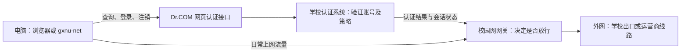
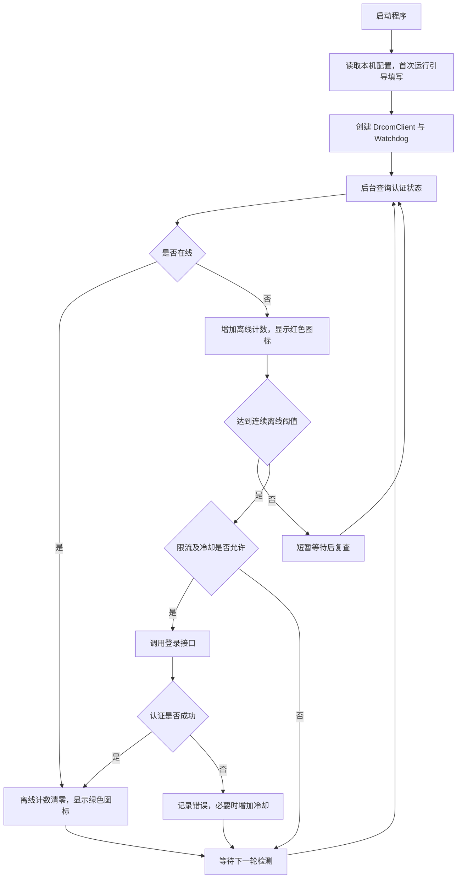

# gxnu-net

广西师范大学校园网（Dr.COM）自动认证与掉线重连工具。使用 Python 实现，支持 Windows 系统托盘、首次运行配置窗口、命令行和开机自启。

## 使用方法

需要 Python 3.10 或更新版本。在 Windows 下执行：

```powershell
python -m pip install -r requirements.txt
python -m gxnu_net --tray
```

也可以双击 `start.bat`。首次运行时填写自己的校园网账号、密码和运营商，程序会将配置保存到本机 `config.ini`。配置模板见 `config.ini.example`。

```powershell
# 查看状态
python -m gxnu_net --status
# 检测并在离线时登录一次
python -m gxnu_net --once
# 手动登录或注销
python -m gxnu_net --login
python -m gxnu_net --logout
# 开启或关闭开机自启
python -m gxnu_net --autostart on
python -m gxnu_net --autostart off
```

托盘提供查看状态、立即重连、打开日志和退出等操作。开机自启使用当前用户的 Windows 注册表 Run 项。

## 校园网认证原理

连接校园 Wi-Fi 或网线，只代表电脑接入了校园网络；能否访问外网还取决于认证会话。认证页面收集账号、密码和运营商选项，向校园网认证服务提交请求。认证系统验证账号，并由网关依据会话及学校策略决定是否允许该终端访问外网。

本项目把网页通常执行的请求写成 Python 客户端：查询认证状态，离线时提交登录，需要下线时提交注销。它不替代学校的认证系统，也不承载上网流量；登录完成后，浏览器等应用仍通过校园网络正常访问外网。



这是按职责划分的逻辑结构。门户、认证后端与网关可能部署在同一设备或不同设备；本项目并未获取学校服务端源码或实际部署拓扑。

## 如何从网页认证实现自动登录

项目技术报告记录的方法是：查看门户首页和前端 `a41.js`、`a40.js`，找到登录函数 `default_login`，提取它调用的接口和表单参数，再结合当时的接口测试确定适用方式。Python 代码直接发送同类 HTTP 请求，不需要自动点击网页，也不需要运行浏览器。

| 环节 | 当前实现 | 作用 |
| --- | --- | --- |
| 查询状态 | `GET /drcom/chkstatus` | 解析 JSONP 响应，`result=1` 代表网关返回在线 |
| 提交认证 | `GET /drcom/login` | 提交 `DDDDD` 账号、`upass` 密码、`R3` 运营商等参数 |
| 主动下线 | `GET /drcom/logout` | 请求结束当前认证会话 |

默认接口域名是 `https://yc.gxnu.edu.cn`，使用默认 HTTPS 端口 443。报告中用于读取配置的 802 端口和 `/eportal/` 接口，不是本程序实际使用的登录路径。

当前默认使用裸学号，不加 `,0,` 前缀或运营商后缀；`en_md5=0` 时密码不做应用层 MD5。`0MKKey=123456` 是协议表单常量，不是个人密码。响应形如 `dr1001({"result":1});`，客户端去掉回调包装后解析 JSON。这些选择来自当时的分析与测试，学校修改协议后需要重新确认。

## 程序的整体结构与执行全过程



| 步骤 | 对应源码 | 如何实现 |
| --- | --- | --- |
| 启动与选模式 | `cli.py`、`gxnu_net_app.py` | 选择命令行、守护或托盘模式；打包运行时定位 exe 目录 |
| 获取用户配置 | `config.py`、`setup_gui.py` | 读取 `config.ini`；首次运行用窗口收集账号、密码和运营商 |
| 构造并发送请求 | `drcom.py` | URL 编码参数，直连认证接口，解析 JSONP，解释网关错误 |
| 判断掉线 | `watchdog.py` | 优先问网关；状态不可判定时才探测备用外网地址；累计离线次数 |
| 自动重连 | `watchdog.py`、`ratelimit.py` | 达到阈值后检查登录频率和冷却，再提交认证；成功后清零计数 |
| 展示及手动操作 | `tray.py` | 后台线程执行检测，通过 Windows 消息通知界面更新图标；提供重连和退出等菜单 |
| 自启与日志 | `autostart.py`、`logging_setup.py` | 写当前用户 Run 项，并保存轮转日志 |

托盘模式默认每 30 秒检测一次，首次离线后 10 秒复查，连续 2 次离线才触发登录。命令行守护模式启动时会先检查并尝试补一次登录，随后进入周期检测；`--once` 只执行单次检查。

自动重连的登录保护为：两次尝试至少间隔 30 秒，5 分钟内最多 3 次；密码错误追加 300 秒冷却，账号锁定追加 600 秒冷却。认证与备用探测显式禁用系统代理，避免开机时代理尚未启动导致请求失败。

## 为什么不能保证永不掉线

这是“掉线检测后重新认证”，不是原生协议的持续心跳保活。会话是否被清除、设备是否互踢由网关策略决定，客户端只能发现掉线后重新登录。因此仍存在检测、确认和认证所需的短暂断网窗口。

技术报告还调研过 Dr.COM 原生 UDP 登录与心跳。该协议通常需要原生登录返回的会话材料 `AUTH_INFO`，当前网页登录客户端没有取得这些材料，不能直接把那套心跳附加到网页会话上。当前源码没有实现 UDP 登录或心跳；报告中的挑战包响应也不能证明完整 UDP 登录已经可用。

进一步阅读：[项目逻辑与设计](docs/ARCHITECTURE.md) · [协议分析与方案选择](docs/PROTOCOL.md)。

## 隐私与安全

- 本仓库仅包含源码、虚构测试数据和配置模板。真实账号配置、日志、原始压缩包和打包程序不入库。
- `config.ini` 明文保存账号密码，请勿提交、分享或截图公开。
- 认证时账号密码会发送给校园网门户，登录接口使用 GET 参数。当前实现关闭 HTTPS 证书及主机名校验，存在中间人攻击风险。
- 门户响应和异常信息可能含账号、IP 或请求信息，分享日志前需要脱敏。
- 发布前的检查范围及处理见 [发布检查](docs/PUBLICATION_REVIEW.md)。

## 测试与打包

```powershell
python -m pip install -r requirements-dev.txt
python tests/test_smoke.py
python -m pytest tests -q
python -m PyInstaller gxnu_net.spec
```

测试使用虚构账号和密码，不进行真实校园网认证。打包产物位于 `dist/`。发布时只复制程序、配置模板和使用说明，不要复制本机 `config.ini` 或日志。

## 目录结构

| 文件 | 用途 |
| --- | --- |
| `gxnu_net/drcom.py` | Dr.COM 请求、JSONP 解析与错误解释 |
| `gxnu_net/watchdog.py` | 掉线确认、自动重连与状态依据 |
| `gxnu_net/ratelimit.py` | 滑动窗口限流与冷却 |
| `gxnu_net/tray.py` | Windows 托盘与后台检测线程 |
| `gxnu_net/setup_gui.py` | 首次运行配置窗口 |
| `gxnu_net/config.py` | 配置加载、模板识别与路径选择 |
| `gxnu_net/autostart.py` | 当前用户开机自启 |
| `gxnu_net/logging_setup.py` | 控制台与轮转日志 |
| `gxnu_net/cli.py` | 命令行入口与各模式调度 |

门户协议或校园网策略变化后，可能需要调整实现。

