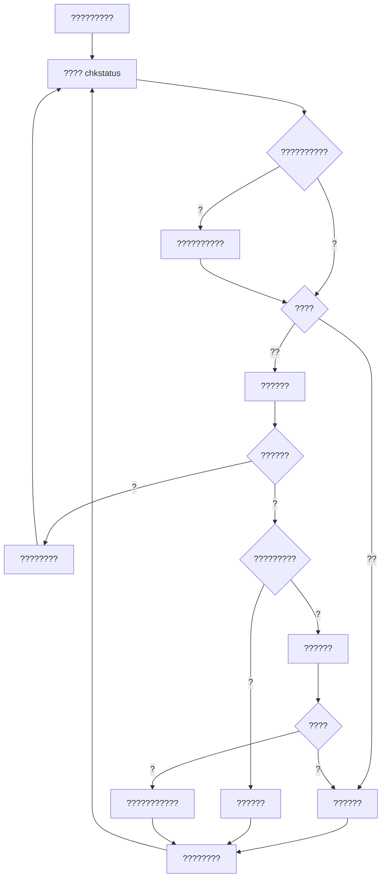

# ???????

## ?????

?????????????????????????????????????????????????????????????????????

?? `gxnu_net_app.py` / `python -m gxnu_net` ?? CLI?CLI ?????????????????????????????????????????????????????????

?????????????? exe ???????????????????????????????????????????

## ????????

`Watchdog.is_online()` ???????????????????????????????????????????? HEAD ???????????????????????????????????????????

`next_delay()` ?????????????????????????????????? 2???????? 10 ??????????????????????????????

## Dr.COM ??

???????????????????????????????

| ?? | ?? | ???? |
| --- | --- | --- |
| ?? | `GET /drcom/chkstatus` | `result` ? 1 ???? |
| ?? | `GET /drcom/login` | `DDDDD` ???`upass` ???`R3` ??? |
| ?? | `GET /drcom/logout` | ??? `user_account` |

???? `https://yc.gxnu.edu.cn`????? callback?jsVersion??? v ???? UA?????? JSONP ??????? JSON?

??????????`DEFAULT_PREFIX` ????`0MKKey=123456` ???????????????`en_md5` ????????????????? MD5 ??? `md5(PID + password + CALG) + CALG + PID` ??????????????????

??? R3?0 ????1 ???2 ???3 ???4 ????????????????????????

## ?????

????????????????????????????????HTTPS ?????????????????????????????????? GET ???????????????????????????????????

## ?????????

`RateLimiter` ???????????????????? 30 ??300 ????? 3 ???????? 300 ???????? 600 ?????????????????????????????????????????????????????

?????????????????????????????????????????????????????????????????????????????? 1 MiB??? 3 ????

## ????

?????? JSONP???????????????????????????????????????????????????????????????????????????????????
