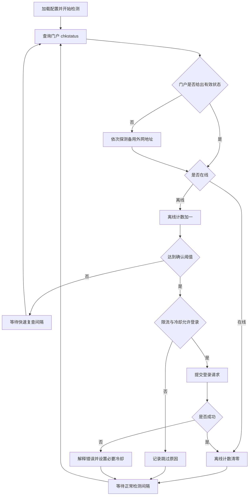

# 项目逻辑与设计

校园网认证链路与完整执行流程见 [README](../README.md#校园网认证原理)。前端协议分析、参数映射及 UDP 方案取舍见 [协议分析与方案选择](PROTOCOL.md)。本文着重说明程序内部职责和控制流程。

## 目标与分层

本项目解决校园网偶尔掉线后需要重复打开认证页面的问题。它把浏览器通常执行的状态查询、登录和注销封装为客户端，再通过守护循环决定何时重连。

入口 `gxnu_net_app.py` 或 `python -m gxnu_net` 调用 CLI。CLI 读取配置，按参数选择状态查询、单次认证、守护或托盘模式。托盘模式把耗时检测放在后台线程，界面展示状态并接收操作。

打包运行时，配置路径优先考虑 exe 所在目录。首次运行或账号仍为占位符时，程序提供配置引导。账号密码从用户配置读取，不内置在程序中。

## 状态到重连的决策

`Watchdog.is_online()` 首先查询网关，只有状态不可判定时才执行外网探测。网关明确返回离线时，不由备用探测覆盖。外网 HEAD 请求成功只提供可达性线索，可能受重定向、白名单或门户劫持影响，不能保证所有业务可用。

`next_delay()` 在离线计数尚未达到阈值时，返回快速复查间隔与正常间隔的较小值。默认阈值为 2，第一次离线后约 10 秒复查。实际恢复延迟还包括首次发现掉线的等待时间和网络请求耗时。

## Dr.COM 接口

以下描述的是源码实现的接口，不代表发布检查重新访问或验证了学校服务。

| 操作 | 路径 | 核心字段 |
| --- | --- | --- |
| 查询 | `GET /drcom/chkstatus` | `result` 为 1 代表在线 |
| 登录 | `GET /drcom/login` | `DDDDD` 账号、`upass` 密码、`R3` 运营商 |
| 注销 | `GET /drcom/logout` | 可携带 `user_account` |

默认门户为 `https://yc.gxnu.edu.cn`。请求附带 callback、jsVersion、随机 v 和浏览器 UA；解析器拆掉 JSONP 回调包装后解析 JSON。

登录默认使用裸账号，`DEFAULT_PREFIX` 为空。`0MKKey=123456` 是协议表单常量，不是用户密码。`en_md5` 默认关闭，密码不做应用层摘要；可选 MD5 分支按 `md5(PID + password + CALG) + CALG + PID` 构造，不能将其视为现代密码保护方案。

运营商 R3 对应：0 校园网、1 电信、2 联通、3 移动、4 校园网专线。学校更改认证参数时，需要相应调整客户端。

## 请求与代理

客户端显式禁用系统代理，避免校园网认证被本机代理转发到错误出口。HTTPS 上下文关闭证书校验以兼容门户证书，这同时降低了连接身份验证保障。登录 GET 查询包含敏感参数，异常或服务端响应可能泄露这些参数，分享日志前需要脱敏。

## 限流、线程与持久化

`RateLimiter` 保存最近尝试时间和滑动窗口历史：最小间隔为 30 秒，300 秒窗口最多尝试 3 次。密码错误追加 300 秒惩罚，锁定追加 600 秒惩罚；由于最小间隔叠加，实际等待可能略长。限流状态仅在内存中，重启会丢失，新进程不能保证遵守之前的冷却。

守护与托盘使用客户端及限流策略，托盘提供立即重连、状态刷新、退出和自启操作。配置和轮转日志保存在本机；认证时仍必须把凭据发给校园网门户。默认日志轮转大小为 1 MiB，保留 3 份历史。

## 验证边界

离线测试覆盖 JSONP、登录参数、密码编码、配置、限流、快速复查和部分托盘行为。发布检查没有使用真实账号联网认证，也没有验证不同校区的实时门户策略。线上接口和系统托盘体验仍以实际运行环境为准。

